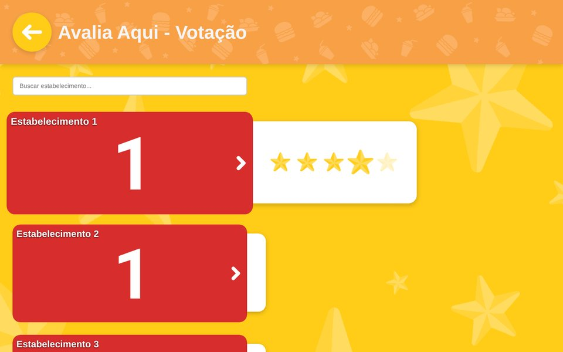
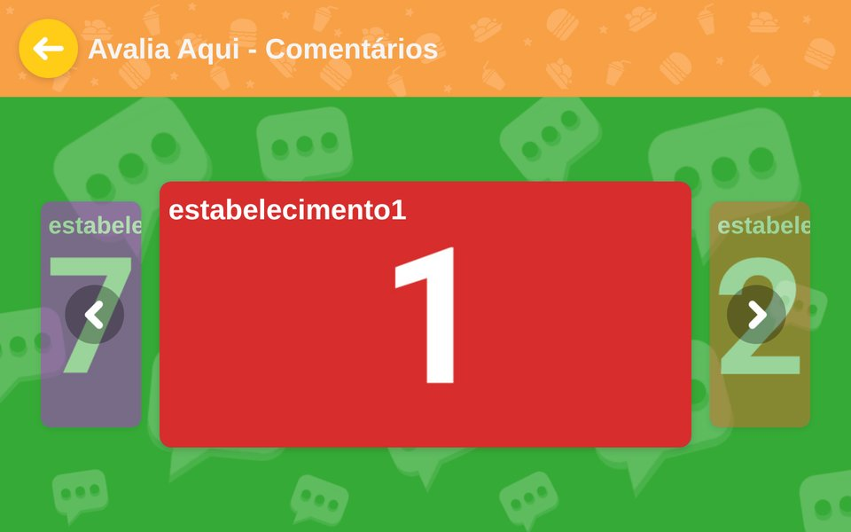
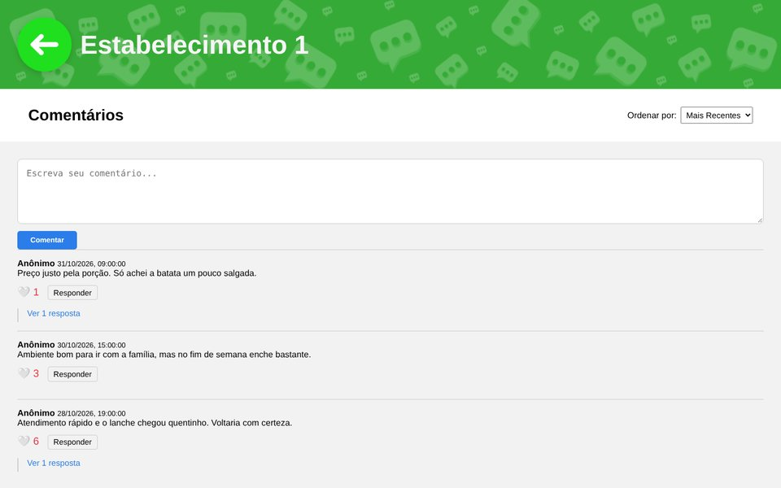
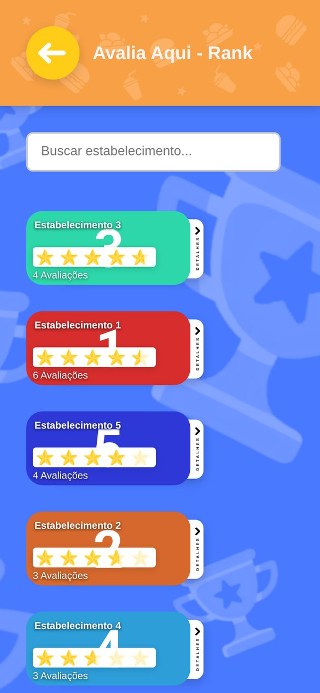
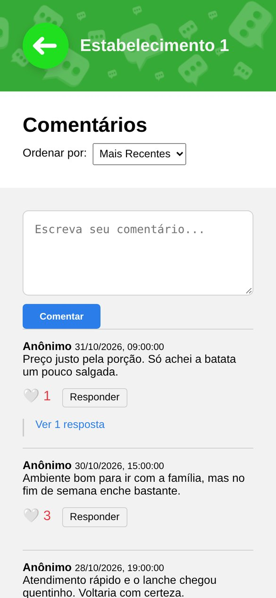

# Avalia Aqui (demo)

Static demo of Avalia Aqui, a website for rating local places: visitors vote with stars, see a ranking by average rating and leave anonymous comments with replies and likes. This version has no backend. A small mock intercepts the `/api/*` requests and stores everything in the browser.

**Live demo:** [avalia-aqui.vercel.app](https://avalia-aqui.vercel.app)
**Full-stack version** (Node.js, Express and SQLite): [PedroRossZny/avalia-aqui](https://github.com/PedroRossZny/avalia-aqui)

The interface is in Brazilian Portuguese.


## Screenshots

Captured from a local copy of the site with sample votes and comments.

| Home | Voting | Ranking |
|---|---|---|
|  |  |  |

| Place carousel | Comments |
|---|---|
|  |  |

On a phone:

| Home | Ranking | Comments |
|---|---|---|
|  |  |  |

Voting, checking the ranking and posting a comment:


## About

I built Avalia Aqui in September 2025 to practice a complete web project: a multi-page frontend in plain HTML, CSS and JavaScript talking to a REST API. The visual design (logo, backgrounds and buttons) is my own.

This repository is the frontend on its own, so it can be hosted as a static site. The API calls are the same ones the [full-stack version](https://github.com/PedroRossZny/avalia-aqui) answers with Express and SQLite; here a mock answers them instead.

## Features

- Star voting from 1 to 5 for each place. Voting again on the same place updates the previous vote instead of adding a new one.
- Ranking ordered by average rating, with partly filled stars, the number of reviews and a details panel for each place.
- Search by name on the voting and ranking pages.
- Carousel for choosing which place to comment on.
- Anonymous comments with replies, likes and sorting by newest or most liked.
- Layout that adapts from desktop to phone.

## How it works

### Mock API

[`js/utils/mockApi.js`](js/utils/mockApi.js) replaces `window.fetch`. Requests to `/api/*` are answered from `localStorage` (`aa_reviews_v1`, `aa_comments_v1` and `aa_ids_v1`), with the same routes and response shapes as the backend; every other request goes to the network as usual. The routes it covers:

| Method | Route | What it does |
|---|---|---|
| GET | `/api/reviews?placeId=` | lists the votes for a place |
| POST | `/api/reviews` | adds a vote |
| PUT | `/api/reviews/:id` | changes a vote |
| GET | `/api/reviews/average/:placeId` | returns the average and the number of votes |
| GET | `/api/comments?placeId=` | returns the comments of a place with their replies, newest first |
| POST | `/api/comments` | adds a comment or a reply |
| POST, DELETE | `/api/comments/:id/like` | adds or removes a like |

### Anonymous visitors

[`js/utils/anon.js`](js/utils/anon.js) creates a random ID with `crypto.randomUUID()` on the first visit and keeps it in `localStorage`. Votes and comments carry that ID, which is how a second vote on the same place becomes an update.

### Partial stars

The ranking draws each star twice, an empty one and a filled one on top, and cuts the filled one with `clip-path: inset()`. A 4.5 average shows four full stars and half of the fifth with only two images.

### Safe comments

Comment and reply text is inserted with `textContent`, never as HTML, so a comment containing markup is shown as plain text.

## Limitations

- Votes and comments stay in the browser that made them. Other visitors do not see them, and clearing the site data erases them. The [full-stack version](https://github.com/PedroRossZny/avalia-aqui) keeps them in a database.
- The seven places are placeholders (Estabelecimento 1 to 7), with numbered images and placeholder descriptions.
- One vote per place per browser is enforced only by the anonymous ID, which a visitor can reset.

## Project structure

```
.
├── index.html                 # home: links to voting, ranking and comments
├── vote.html                  # star voting
├── rank.html                  # ranking by average rating
├── carrossel.html             # carousel to pick a place to comment on
├── estabelecimento1-7.html    # one comments page per place
├── assets/                    # logo, backgrounds, buttons, arrows, stars and place images
├── css/                       # style.css, carrossel.css, comentarios.css
└── js/
    ├── votes.js               # voting page
    ├── ranks.js               # ranking page
    ├── carrossel.js           # carousel
    ├── estabelecimento.js     # comments, replies, likes and sorting
    └── utils/
        ├── anon.js            # anonymous visitor ID
        └── mockApi.js         # fetch replacement backed by localStorage
```

## Running locally

There is no build step, but the scripts are ES modules, so the pages need to be served over HTTP rather than opened as files. Any static server works:

```bash
git clone https://github.com/PedroRossZny/avalia-aqui-demo.git
cd avalia-aqui-demo
python3 -m http.server 8080
```

Then open http://localhost:8080.

## License

The code is released under the [MIT License](LICENSE). The logo and the other images in `assets/` are not covered by it.

## Author

Pedro Ross. [GitHub](https://github.com/PedroRossZny) | [LinkedIn](https://www.linkedin.com/in/pedro-ross)
